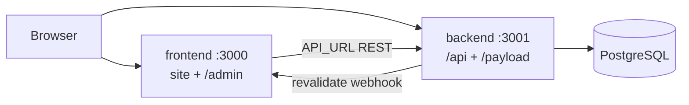

# Citata — структура проекта

Миграция [citata-pr.ru](https://citata-pr.ru) с Webflow.  
Монорепо npm workspaces: **`frontend/`** (:3000) + **`backend/`** (:3001).

Деплой: [DEPLOY.md](./DEPLOY.md) · Вёрстка админки: [admin-panel-ui-only.md](./admin-panel-ui-only.md)

---

## Фазы

| Фаза | Статус | Описание |
|------|--------|----------|
| **1. Публичный фронт** | ✅ | Сайт на фикстурах |
| **2. Фронт админки (UI)** | ✅ | `/admin` — кастомная панель |
| **3. Payload + API** | ✅ | Backend отдельно, HTTP-мост |
| **3b. Split FE/BE** | ✅ | `frontend/` + `backend/` workspaces |
| **4. Миграция контента** | 📋 | Webflow → CMS, медиа → S3 |
| **5. Прод (VPS + S3)** | 📋 | PM2 × 2, Nginx, Certbot |

---

## Архитектура процессов



| Пакет | Порт | PM2 (прод) | Содержимое |
|-------|------|------------|------------|
| `frontend/` | 3000 | `citata-web` | Публичный сайт, `/admin`, фикстуры, GSAP |
| `backend/` | 3001 | `citata-api` | Payload, коллекции, seed, `/payload`, `/api` |

---

## Локальный запуск

```bash
npm install
npm run dev          # оба
npm run dev:front    # :3000
npm run dev:back     # :3001
```

| URL | Что |
|-----|-----|
| http://localhost:3000 | Сайт |
| http://localhost:3000/admin | Кастомная админка |
| http://localhost:3001/payload | Payload UI |
| http://localhost:3001/api/* | REST |

Env:
- `frontend/.env` — `CONTENT_SOURCE`, `API_URL`, `PAYLOAD_API_KEY`, `ADMIN_*`, `REVALIDATE_SECRET`
- `backend/.env` — `DATABASE_URL`, `PAYLOAD_SECRET`, `FRONTEND_URL`, `REVALIDATE_SECRET`

`CONTENT_SOURCE=fixtures` (по умолчанию) — фронт без БД.  
Запись из `/admin` требует `PAYLOAD_API_KEY` (Users → API Key в Payload).

---

## Frontend (`frontend/src/`)

| Путь | Назначение |
|------|------------|
| `app/(frontend)/` | Публичные страницы |
| `app/(cms-admin)/admin/` | Кастомная CMS UI |
| `content/` | Фикстуры |
| `lib/content-*.ts` | Чтение (fixtures или HTTP → backend) |
| `lib/api/payload-client.ts` | HTTP-клиент к `/api` |
| `lib/admin/content-actions.ts` | Server Actions → backend REST |
| `lib/map-*.ts` | Payload JSON ↔ фронт-модель |
| `styles/admin.css` | Стили из admin-panel-ui-only.md |

---

## Backend (`backend/src/`)

| Путь | Назначение |
|------|------------|
| `payload.config.ts` | PostgreSQL, S3, SEO, CORS |
| `collections/` | Cases, Events, Articles, Authors, Media, PressMentions, Users |
| `globals/SiteSettings.ts` | Настройки сайта |
| `hooks/revalidate*.ts` | Webhook на `FRONTEND_URL/api/revalidate` |
| `app/(payload)/` | `/payload` + `/api` |
| `scripts/seed-*.ts` | Импорт фикстур в PG |

Access: публичный `read` для опубликованных кейсов/статей; Users с `useAPIKey: true`.

---

## Контент-модель

Единые типы в `frontend/src/content/types.ts` (копия в `backend/src/content/`).  
Мапперы: `map-case`, `map-event`, `map-article`, `map-site`, `map-press`.  
Тесты: `npm test` (frontend).

Seed:

```bash
npm run seed -w backend
# seed:events — бывшие новости; seed:articles — no-op (пустые «Статьи»)
```

---

## Дерево репозитория

```
Citata/
├── frontend/          # Next :3000
├── backend/           # Payload Next :3001
├── doc/
├── scripts/           # deploy (обновить под 2 PM2)
├── package.json       # workspaces
└── _legacy_monolith/  # старые seed-скрипты до сплита (можно удалить)
```

---

## Планируется

- [ ] E2E с `CONTENT_SOURCE=payload` + API key
- [ ] S3 медиа + `/admin/media`
- [ ] Визуальный block editor
- [ ] Удалить `_legacy_monolith/`
- [ ] Прод: два PM2 + Nginx (`/` → 3000, `/api`+`/payload` → 3001)
